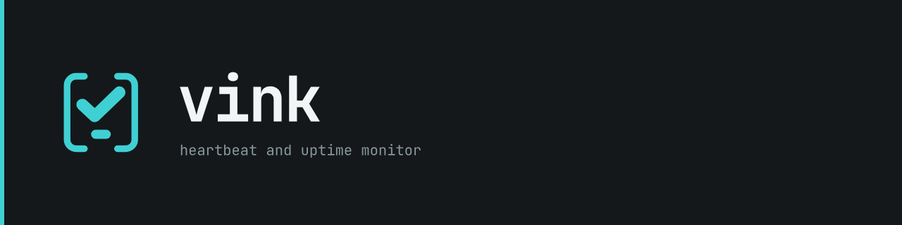
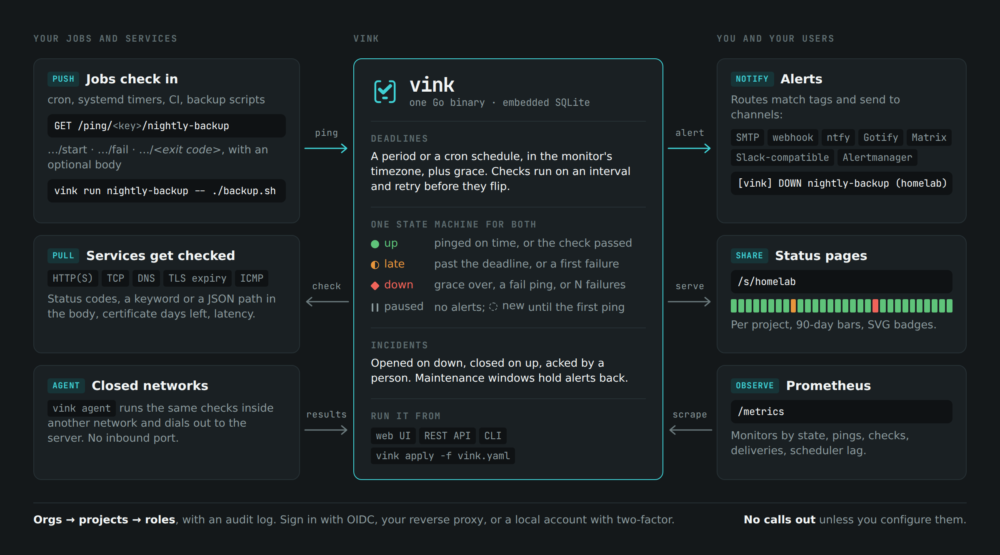
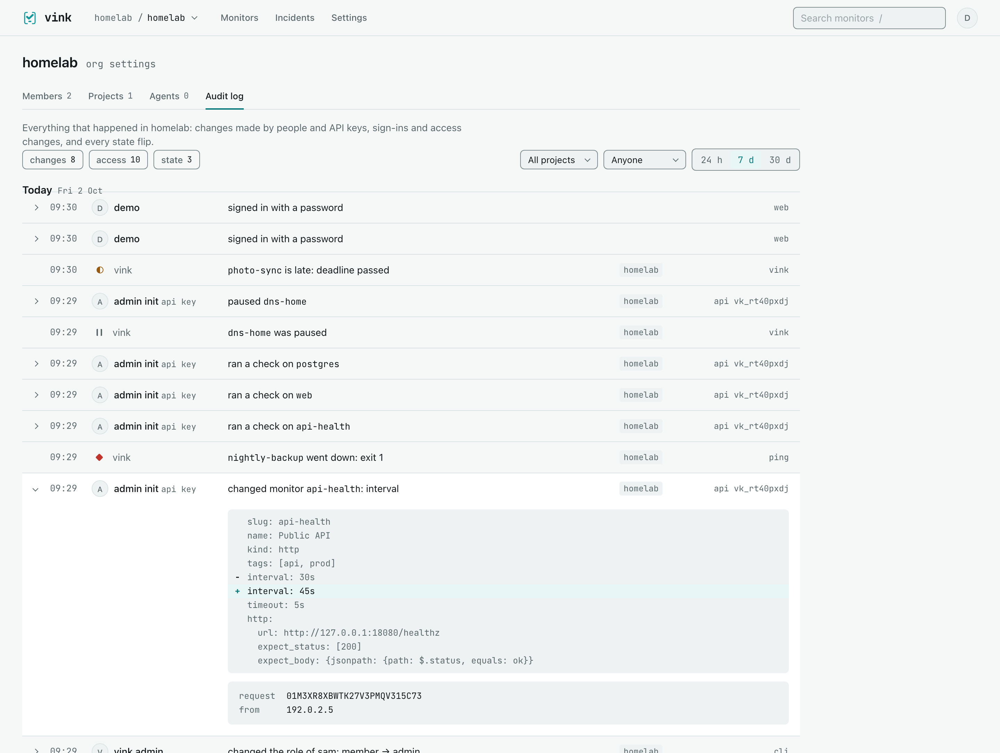
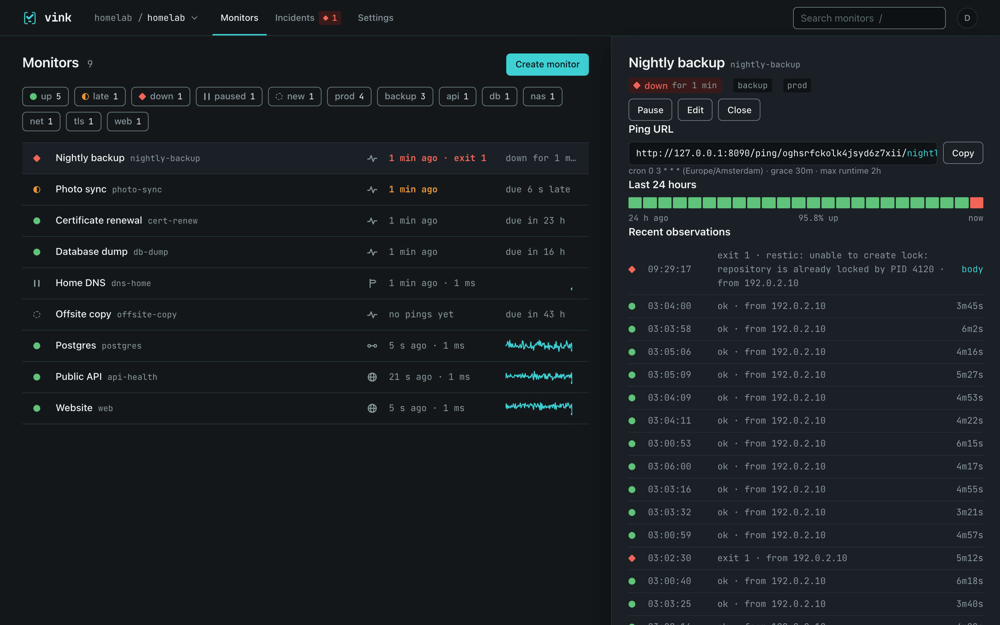

Monitoring a production estate needs two kinds of signal. Services are probed from the outside: does the API answer, does the certificate still have a month to run. Scheduled work cannot be probed that way. A backup, an ETL job or a certificate renewal is only visible when it reports in, so the monitor has to notice when a report fails to arrive.

The market ships these as separate products. Heartbeat receivers in the style of Healthchecks sit on one side, probers in the style of Uptime Kuma on the other, each with its own users, alert routing and status pages. The self-hosted ones are mostly single-user, and the hosted ones cannot see inside a closed network.

[vink](https://github.com/w4jnl/vink) is our answer. It is one Go binary with embedded SQLite, in which push heartbeats and pull checks feed one state machine, one incident list, one set of alert routes and one set of status pages. It is multi-tenant from the first migration and built to install air-gapped.

This article is the technical account. The user-facing story is on [Jaro's personal site](https://jaro.w4j.nl/posts/vinkheartbeatmonitor/), and vink's sibling, the tmux agent sidebar flok, has a [deep dive](/posts/flokdeepdive/) of its own.



## Design principles

vink is built from a design document that fixes four principles before any code:

1. **Tenancy is structural.** Every row carries its project or org, every query takes a scope, and tooling rejects a query that forgets it.
2. **One state machine.** A ping, a local check result and an agent's result are the same `Observation` type.
3. **Simple surface, flexible core.** The UI has one list and one drawer per entity. Anything it cannot express is reachable through the API and a declarative YAML file.
4. **Boring, static, offline.** One process, one file on disk, no runtime dependencies, and no outbound connection unless configured.

### vink at a glance

| | |
|---|---|
| binary | static, no cgo, about 24.6 MB stripped on linux/amd64 |
| state | one SQLite file with 27 tables, plus a 32-byte key file |
| Go code | about 47,600 lines, plus 19,600 lines of tests in 338 test functions |
| SQL | 223 hand-written queries, compiled to Go by sqlc |
| interfaces | web UI, REST API with an OpenAPI spec, CLI, YAML apply |
| release | 0.2.3 of 9 October 2026, MIT licence |

## Architecture

One process holds four transports, a service layer, an engine and a store. The transports never touch the database: a handler parses the request, calls one service method and renders the result.


%%{init: {"theme":"base","themeVariables":{"primaryColor":"#e3f4f5","primaryTextColor":"#14181A","primaryBorderColor":"#12999D","secondaryColor":"#fbe9d4","secondaryBorderColor":"#E8963C","tertiaryColor":"#eef1f1","tertiaryBorderColor":"#8A999C","lineColor":"#8A999C","textColor":"#14181A","nodeTextColor":"#14181A","clusterBkg":"#f3f6f6","clusterBorder":"#8A999C","titleColor":"#14181A","edgeLabelBackground":"#eef1f1","labelBackgroundColor":"#eef1f1","labelColor":"#14181A"}}}%%
flowchart TB
    subgraph C["callers"]
        BR["browser"]
        CLI["vink CLI"]
        JOB["jobs and scripts"]
        AG["vink agent"]
    end
    subgraph T["transports"]
        UI["web UI<br/>html/template + htmx"]
        API["REST API<br/>/api/v1"]
        PING["ping ingress<br/>/ping/…"]
        GW["agent gateway<br/>/agent/v1"]
    end
    BR --> UI
    CLI --> API
    JOB --> PING
    AG --> GW
    UI --> SVC
    API --> SVC
    PING --> SVC
    GW --> SVC
    SVC["service layer<br/>scope · roles · transactions · audit"]
    SVC --> DB[("SQLite · WAL<br/>1 writer + 8 readers")]
    SVC -- "MonitorChanged" --> BUS(("bus"))
    subgraph E["engine"]
        SCH["scheduler<br/>sleeps until next_due_at"]
        POOL["checker pool<br/>32 workers"]
        DIS["dispatcher<br/>drains the outbox"]
    end
    BUS --> SCH
    BUS --> POOL
    DB -- "outbox rows" --> DIS
    DIS --> OUT["notifiers: SMTP · webhook · ntfy<br/>Gotify · Matrix · Slack · Alertmanager"]


- **The CLI is a client of the REST API.** It shares nothing with the server beyond the domain types and the apply schema. Its pings go through the same zero-dependency Go module that programs use.
- **The service layer owns authorization and transactions.** Auth middleware sets a scope once, with the org, project, user and role, it travels in the context, and every service method and query takes it.
- **The engine is three loops and a bus,** and like the transports it works through the service layer. After every commit that touches a monitor, the service publishes `MonitorChanged`, and the scheduler and checker pool treat it as "something changed, look again". Publishing never blocks: a subscriber that falls behind loses events and a counter records how many. That is safe because each loop also re-reads its due list at least every 30 seconds.

### Storage

SQLite comes through `modernc.org/sqlite`, a pure-Go translation of SQLite, so the binary stays static and cross-compiles without a C toolchain. The database is opened twice:

| connection | settings | role |
|---|---|---|
| writer | one connection, `_txlock=immediate` | every write; `BEGIN IMMEDIATE` means a transaction never has to upgrade its lock half-way |
| readers | pool of eight, `query_only` | reads that do not need the writer |

Both run in WAL mode with `synchronous=NORMAL`, `busy_timeout=5000` and foreign keys on. IDs are ULIDs and timestamps are Unix milliseconds in UTC. Scope ids are copied onto the hot tables (monitors, observations, events), so no scope check needs a join.

Migrations are dbmate-format SQL files, embedded and applied at start by vink's own small runner, because dbmate's SQLite driver needs cgo. `vink migrate dump` writes `db/schema.sql`, which is sqlc's input, so the generated Go query code always matches the schema the migrations produce. Backups use `VACUUM INTO`, which writes a compact, consistent copy while the server keeps running.

## The ping path

A ping is the hottest path in the system and the least authenticated one: the ping key in the URL is an address, not a secret. The ingress is its own handler group, with no session, no CSRF token and no HTML anywhere on the path, and it checks the cheap things first.


%%{init: {"theme":"base","themeVariables":{"primaryColor":"#e3f4f5","primaryTextColor":"#14181A","primaryBorderColor":"#12999D","secondaryColor":"#fbe9d4","secondaryBorderColor":"#E8963C","tertiaryColor":"#eef1f1","tertiaryBorderColor":"#8A999C","lineColor":"#8A999C","textColor":"#14181A","nodeTextColor":"#14181A","clusterBkg":"#f3f6f6","clusterBorder":"#8A999C","titleColor":"#14181A","edgeLabelBackground":"#eef1f1","labelBackgroundColor":"#eef1f1","labelColor":"#14181A"}}}%%
flowchart TB
    R["GET · POST · HEAD · PUT<br/>/ping/{key}/{slug}/{signal}"] --> IP{{"per-address limit<br/>300 a minute"}}
    IP -- "ok" --> K{{"key, slug and<br/>signal known?"}}
    K -- "yes" --> M{{"method allowed<br/>for this monitor?"}}
    M -- "yes" --> ML{{"per-monitor limit<br/>10 a minute, burst 30"}}
    ML -- "ok" --> B{{"declared body<br/>within the limit?"}}
    B -- "yes" --> TX["<b>one write transaction</b><br/>load the monitor · engine.Apply<br/>insert the observation and its body<br/>update state and next_due_at<br/>event · incident · outbox rows"]
    TX --> PUB["publish MonitorChanged"] --> OK["200 OK"]
    IP -- "over: 429" --> X["rejected<br/>nothing stored"]
    K -- "no: 404, one body<br/>for every unknown" --> X
    M -- "no: 405" --> X
    ML -- "over: 429" --> X
    B -- "no: 413" --> X
    classDef err fill:#fde4e2,stroke:#F0645A,stroke-width:1.5px,color:#14181A
    classDef good fill:#dff3e5,stroke:#5FC47A,stroke-width:1.5px,color:#14181A
    classDef tx fill:#e3f4f5,stroke:#12999D,stroke-width:2.5px,color:#14181A
    class X err
    class OK good
    class TX tx


Everything a ping changes happens in that one transaction: the observation and its body, the monitor's new state and next deadline, the event row for a flip, the incident it opens or closes, and the outbox rows for the alerts it causes. A crash leaves all of it or none of it. The design target for a ping without a body is a p99 under 5 ms on SQLite.

A few details make the ingress pleasant to integrate with:

- **Signals live in the path.** `/start`, `/fail`, `/log` and `/<exit code>` sit next to the plain ping, and `?rid=` pairs a start with its finish so overlapping runs get the right durations.
- **Bodies are evidence.** By default up to 64 kB of a ping's body is stored with the observation. A streamed body that runs over is cut and flagged, and a `Ping-Body-Limit` header tells clients the limit to cut to.
- **Monitors can create themselves.** `?create=1` makes an unknown slug into a heartbeat, with its schedule, grace and tags taken from the query. Settings that do not make a valid monitor get a `400` with one line per problem, and only after the key has checked out.
- **One handler, two listeners.** Pings can also be served on a second plain-HTTP listener, so jobs can bypass a slow proxy, and both listeners share one set of rate limits.

A key leaked in a crontab can be rotated from the project's keys tab. The old key keeps working for 24 hours, so jobs can be updated without missed pings.

## One state machine

The state machine is a pure function:

```go
func Apply(m *domain.Monitor, obs *domain.Observation, now time.Time, loc *time.Location) (Decision, error)
```

It returns a `Decision` with the new state, the reason, the streak counters, the next deadline, and sometimes a synthetic observation for the caller to store. It never touches the database, so every transition is a table test. A scheduler tick is the same call with no observation. Pull checks go through its sibling, `ApplyCheck`.


%%{init: {"theme":"base","themeVariables":{"primaryColor":"#e3f4f5","primaryTextColor":"#14181A","primaryBorderColor":"#12999D","secondaryColor":"#fbe9d4","secondaryBorderColor":"#E8963C","tertiaryColor":"#eef1f1","tertiaryBorderColor":"#8A999C","lineColor":"#8A999C","textColor":"#14181A","nodeTextColor":"#14181A","clusterBkg":"#f3f6f6","clusterBorder":"#8A999C","titleColor":"#14181A","edgeLabelBackground":"#eef1f1","labelBackgroundColor":"#eef1f1","labelColor":"#14181A"}}}%%
flowchart TB
    P(["‖ paused"]) -- "resume" --> N(["◌ new"])
    N -- "first ok ping<br/>or passing check" --> U(["● up"])
    N -- "deadline passed" --> L(["◐ late"])
    U -- "deadline + tolerance passed,<br/>or a confirmed failed check" --> L
    L -- "ok ping or<br/>passing check" --> U
    L -- "grace over, or<br/>failure_threshold reached" --> D(["◆ down"])
    U -- "fail ping, non-zero exit,<br/>run timeout" --> D
    D -- "recovery_threshold<br/>oks in a row" --> U
    classDef up fill:#dff3e5,stroke:#5FC47A,stroke-width:2px,color:#14181A
    classDef late fill:#fbe9d4,stroke:#E8963C,stroke-width:2px,color:#14181A
    classDef down fill:#fde4e2,stroke:#F0645A,stroke-width:2px,color:#14181A
    classDef muted fill:#eef1f1,stroke:#8A999C,stroke-width:2px,color:#14181A
    classDef fresh fill:#eef1f1,stroke:#8A999C,stroke-width:2px,stroke-dasharray:4 3,color:#14181A
    class U up
    class L late
    class D down
    class P muted
    class N fresh


Every flip writes an event. Entering `down` opens an incident, and leaving it closes the incident. Any state can be paused, and a resumed monitor starts again as `new`, with its deadline counted from the moment of resuming.

### Heartbeats: deadlines

A heartbeat's deadline comes from its schedule, computed in the monitor's own timezone:

| moment | rule | cron `0 3 * * *`, tolerance 30 s, grace 30 m |
|---|---|---|
| expected | next schedule occurrence after the last ok ping, or the last ok ping plus the period | 03:00:00 |
| late | expected plus tolerance | 03:00:30 |
| down | expected plus grace | 03:30:00 |

The tolerance, 30 seconds by default, exists so that a job which fires at its deadline and pings a second later does not flap to `late` and back on every run. Beyond deadlines, the heartbeat rules are:

- **Run timeouts.** A `start` without a finish within `max_runtime` produces a synthetic `fail` observation with the reason `run_timeout`. The caller stores it like any other.
- **Thresholds.** `failure_threshold` is 1 by default and can be raised so a job may fail once quietly. `recovery_threshold` can ask for several good runs before an incident closes.
- **Daylight saving.** Cron occurrences are computed in the monitor's location. A wall-clock time that does not exist on a spring-forward night is skipped, and one that occurs twice on a fall-back night fires once. The test table covers Amsterdam, New York and Lord Howe Island, whose clocks move by half an hour.

### Pull checks: confirmation before alarm

| step | default | effect |
|---|---|---|
| confirm | 2 retries, 5 s apart | a failed attempt is retried before it counts |
| first counted failure | | `up` turns `late`: failing, not yet confirmed |
| `failure_threshold` | 3 in a row | `late` turns `down` and an incident opens |
| `recovery_threshold` | 1 | ok attempts needed to leave `down` |

A TLS check inside its `warn_days` returns a passing result flagged `Warn`, which keeps the monitor `late` without counting as a failure. Inside `crit_days` it fails. The checker interface is deliberately small, and adding a kind is one file plus a registry line:

```go
type Checker interface {
	Kind() domain.Kind
	Check(ctx context.Context, spec *domain.PullSpec, env Env) Result
}
```

### Two overrides: maintenance and missing agents

- **Maintenance windows** are one-off or weekly, with a timezone, and match monitors by tag. Inside a window a monitor still records everything, but a flip that would reach `down` stops at `late` and no deliveries are enqueued. A heartbeat held this way is looked at again when the window ends.
- **A monitor whose agent goes quiet** turns `late` with the reason `agent offline`. It never counts as a failure, so a monitor never goes `down` for lack of an agent.

## A scheduler that sleeps

A heartbeat costs nothing while it waits. Every decision recomputes the monitor's `next_due_at` in the same transaction, and that column is indexed. The scheduler reads the earliest value and sleeps until then, at most 30 seconds or until a bus event. It then ticks every due monitor in batches of 100 and goes back to sleep.

When a pass runs more than five seconds late it logs a warning, and the lag is exported as `vink_scheduler_lag_seconds`. `/readyz` fails when the scheduler has not ticked for 30 seconds, so a supervisor can restart a wedged process.

Pull checks use the same sleep-until-due loop on a pool of 32 workers by default. A per-monitor mutex keeps attempts from overlapping, also when someone presses *check now* during an attempt. A monitor whose run errored is left alone for 30 seconds.

## Alerts through an outbox

A flip that should alert writes rows to an outbox table, `deliveries`, in the same transaction as the flip. Nothing is sent inside the transaction, and nothing is lost when the process dies right after the commit: the dispatcher picks the rows up when it starts again.


%%{init: {"theme":"base","themeVariables":{"primaryColor":"#e3f4f5","primaryTextColor":"#14181A","primaryBorderColor":"#12999D","secondaryColor":"#fbe9d4","secondaryBorderColor":"#E8963C","tertiaryColor":"#eef1f1","tertiaryBorderColor":"#8A999C","lineColor":"#8A999C","textColor":"#14181A","nodeTextColor":"#14181A","clusterBkg":"#f3f6f6","clusterBorder":"#8A999C","titleColor":"#14181A","edgeLabelBackground":"#eef1f1","labelBackgroundColor":"#eef1f1","labelColor":"#14181A"}}}%%
flowchart LR
    F["state flip<br/>inside the ping or<br/>tick transaction"] --> O[("deliveries<br/>outbox")]
    O --> D{"dispatcher<br/>every second"}
    D -- "an earlier row for this<br/>monitor and channel is pending" --> H["hold:<br/>an up never<br/>overtakes its down"]
    D -- "send, 10 s timeout" --> R{"delivered?"}
    R -- "yes" --> OK["mark delivered"]
    R -- "no" --> B["retry after<br/>30 s · 2 m · 10 m · 30 m · 2 h"]
    B --> O
    R -- "sixth failure" --> X["keep the error,<br/>stop retrying"]


The ordering rule is a single query, and it shows the annotation convention the tenancy tooling relies on, which comes up again below:

```sql
-- name: CountEarlierPendingDeliveries :one
-- tenancy: root (dispatcher keeps per-monitor order)
SELECT COUNT(*) FROM deliveries
WHERE monitor_id = ? AND channel_id = ? AND delivered_at IS NULL AND failed_at IS NULL AND created_at < ?;
```

What the outbox delivers is designed to need no follow-up:

- **Alerts say why.** A `down` caused by a ping carries that ping's `?msg=`, or else the tail of its body (the last 20 lines, at most 2,000 bytes), and its exit code, in every channel.
- **Routing follows tags.** A route sends `down`, `up` and optionally `late` for monitors that carry all of its tags. Org-level routes fire beside each project's own routes.
- **Repeats and acknowledgement.** A route can repeat its alert while the incident stays unacknowledged. Every alert carries an acknowledgement link that is HMAC-signed with the instance key, works for seven days and needs no sign-in.
- **The channel set is small and open.** The built-in kinds are SMTP, ntfy, Gotify, Matrix, Slack-compatible webhooks and Alertmanager. A generic webhook takes a Go template, and templates for PagerDuty, Opsgenie, Discord and Telegram ship with vink. Like checkers, notifiers sit behind a three-method interface:

```go
type Notifier interface {
	Kind() domain.ChannelKind
	Validate(cfg json.RawMessage) error
	Send(ctx context.Context, cfg json.RawMessage, n Notification) error
}
```

## Closed networks: agents and egress

The deployment we design for is a corporate network in segments. The vink server lives where people can reach it, and the services worth checking often live where it cannot. vink's answer is that every arrow points at the server and nothing needs an inbound port.


%%{init: {"theme":"base","themeVariables":{"primaryColor":"#e3f4f5","primaryTextColor":"#14181A","primaryBorderColor":"#12999D","secondaryColor":"#fbe9d4","secondaryBorderColor":"#E8963C","tertiaryColor":"#eef1f1","tertiaryBorderColor":"#8A999C","lineColor":"#8A999C","textColor":"#14181A","nodeTextColor":"#14181A","clusterBkg":"#f3f6f6","clusterBorder":"#8A999C","titleColor":"#14181A","edgeLabelBackground":"#eef1f1","labelBackgroundColor":"#eef1f1","labelColor":"#14181A"}}}%%
flowchart LR
    JOBS["cron jobs, CI,<br/>backup scripts"] -- "pings over HTTP(S)" --> S
    subgraph HOME["network vink lives in"]
        S["vink server"]
    end
    subgraph SEG1["closed segment · site=dc1"]
        A1["vink agent"] -. "runs checks" .-> T1["internal services"]
    end
    subgraph SEG2["closed segment · site=lab"]
        A2["vink agent"] -. "runs checks" .-> T2["internal services"]
    end
    A1 == "outbound WebSocket" ==> S
    A2 == "outbound WebSocket" ==> S
    S -- "only what is configured:<br/>checks · alerts · OIDC<br/>via proxy and CA, logged" --> EXT["targets and<br/>notification services"]


### Probe agents

An agent is the same binary, started as `vink agent --server wss://… --token vat_…`. It dials out over WebSocket, announces its labels, runs the checks it is given and reports the results. It never listens on a port and keeps nothing on disk.


%%{init: {"theme":"base","themeVariables":{"primaryColor":"#e3f4f5","primaryTextColor":"#14181A","primaryBorderColor":"#12999D","secondaryColor":"#fbe9d4","secondaryBorderColor":"#E8963C","tertiaryColor":"#eef1f1","tertiaryBorderColor":"#8A999C","lineColor":"#8A999C","textColor":"#14181A","nodeTextColor":"#14181A","clusterBkg":"#f3f6f6","clusterBorder":"#8A999C","titleColor":"#14181A","edgeLabelBackground":"#eef1f1","labelBackgroundColor":"#eef1f1","labelColor":"#14181A","signalColor":"#5A686B","signalTextColor":"#14181A","noteBkgColor":"#fbe9d4","noteBorderColor":"#E8963C","noteTextColor":"#14181A","actorBkg":"#e3f4f5","actorBorder":"#12999D","actorTextColor":"#14181A","labelBoxBkgColor":"#e3f4f5","labelBoxBorderColor":"#12999D","loopTextColor":"#14181A"}}}%%
sequenceDiagram
    box rgb(243,246,246)
    participant A as vink agent
    participant S as vink server
    end
    A->>S: dial /agent/v1 with a Bearer token
    A->>S: hello: version, labels, checks supported
    S->>A: assign: monitor, kind, spec, interval, version
    loop every interval
        Note over A: run the check with internal/checks
        A->>S: result: monitor, attempt time, ok, latency, detail
    end
    A-->>S: heartbeat every 30 s
    S->>A: revoke: monitor
    Note over A,S: quiet for 2 minutes: its monitors turn late with the reason agent offline


- **Same code everywhere.** The agent runs the server's own `internal/checks` package, so a check behaves identically locally and remotely.
- **Assignment by labels.** A monitor names an agent or a label selector such as `site=dc1`. The least loaded matching agent wins, ties go by name, and the assignment sticks while that agent stays connected.
- **Edits versus state changes.** An `assign` carries a version, an FNV-64a hash of the spec, so a state change on the monitor is not mistaken for an edit.
- **Trust without a CA.** The agent can pin the server certificate by its SHA-256 fingerprint. With a pin set, the pin is the verification and the CA chain is not consulted, which suits internal CAs the agent host does not trust.
- **Resilience.** The agent reconnects with exponential backoff from 1 to 60 seconds. Through an agent, the minimum check interval is 30 seconds instead of 10.

### Egress control you can prove

"Does not phone home" is easy to claim and hard to prove. vink makes it structural.

- **One place opens connections.** The package `internal/outbound` holds the dialer, an HTTP transport with the configured proxy and CA bundle, and the resolver. Checkers, notifiers, the OIDC client and the agent all use it.
- **Private targets can be refused safely.** With `allow_private_targets = false`, the dialer resolves the host once and refuses loopback, RFC 1918, link-local and unspecified addresses. It then dials the address it vetted, so a DNS answer that changes between the check and the connect cannot slip through.
- **Every connection is observed.** The dialer reports each connection to an `Observe` hook, and `[outbound] egress_log` writes them to a file. `TestNoEgress` runs a server with the log on and asserts that an idle install opens nothing. When we ran a test install with one HTTP check and one ntfy channel, the log listed exactly those two hosts.
- **A gate keeps it that way.** `scripts/check-egress.sh`, part of `make lint`, greps the Go code for anything that opens a connection: dials, HTTP clients, `http.DefaultClient`, resolvers, SMTP and WebSocket dials. A match outside a short allowlist fails, and every allowlist entry carries its reason. The gate also fails when an entry stops matching, so the list cannot rot.
- **The UI loads nothing from outside.** htmx 4.0.0, the fonts and the icons are embedded in the binary.

## Multi-tenancy you can test

Orgs hold projects, and a membership gives one of four roles in every project of the org. Instance admins sit above them.

| role | adds to the role above |
|---|---|
| viewer | read monitors, incidents, history and status |
| member | edit monitors, channels, routes, maintenance and pages; acknowledge; see the ping key; make read-only API keys |
| admin | rotate the ping key; read-write keys; projects, members and agents; org channels, routes and pages |
| owner | transfer or delete the org |

Isolation is enforced at three levels, and two of them are tooling, not convention:

1. **Every query is scoped.** Every query on a project-scoped table filters by `project_id`, and every query on an org table by `org_id`.
2. **A gate reads the SQL.** `scripts/check-tenancy.sh` runs in CI and walks every sqlc query. A query that touches a project table without `project_id`, or an org table without `org_id`, fails the build. The only exceptions are queries annotated `-- tenancy: root`, such as the scheduler's, the dispatcher's and the auth lookups that establish a scope, and `-- tenancy: org`. Of 223 queries, 62 are root and 28 are org, each with its reason in the annotation.
3. **A test walks the router.** The cross-tenant test builds two tenants, mounts the real API router and walks its own route list. It calls every route with tenant A's ids as tenant B, using a read-write key, a read-only key, org keys and a browser session, and expects `404` every time. A new route is covered the moment it is registered. The answer is `404` rather than `403`, so a response never reveals that a resource exists in another tenant.



The audit log completes the picture. The service layer writes each audit row through the transaction of the change it describes, so a rolled-back change leaves no row and a committed one always has one. A change row holds the YAML before and after, with secrets shown as `***`, plus the request id and address. Rows are never edited or pruned, and state flips appear in the same log as vink's own rows.

## Identity without an identity stack

vink contains no Kerberos, SAML or LDAP code. It offers three ways in, and all three end in the same subject and groups.

- **Trusted proxy headers**, for Authelia, oauth2-proxy or Apache with Kerberos. Identity headers count only from `trusted_cidrs` and only with a shared secret header that the proxy adds, so a client cannot inject `Remote-User` through a forgotten proxy rule. The API, ping, status and metrics paths never read them.
- **OpenID Connect**, using the authorization-code flow with PKCE. The state and nonce are checked, and a replayed state is refused.
- **Local accounts**, with argon2id passwords (`t=2`, 64 MB, `p=1`), sessions you can list and revoke, TOTP from a standard-library implementation with a QR code the server draws, and ten recovery codes.

Groups named `vink:<org>:<role>` grant roles. Where group names cannot be shaped, such as Active Directory behind Apache, `roles = "vink"` keeps role management in vink instead.

Machine access follows the same scoping:

- **Project API keys** are read-only or read-write. They are stored as argon2id hashes with an 8-character lookup prefix and shown once.
- **Org keys** may call only the org-wide export and apply.
- **Instance admin keys** (`vka_…`) always expire, after 30, 90 or 365 days. They can be limited to address ranges, and they are revoked when their creator stops being an instance admin.

At rest, channel configurations and TOTP secrets are sealed with XChaCha20-Poly1305 under `secret.key`. The same key signs acknowledgement links and status-page password cookies.

## A web UI without a build step



- **No frontend toolchain.** The UI is `html/template` with vendored htmx 4.0.0: no JavaScript framework, no `node_modules`, nothing from a CDN.
- **Progressive enhancement.** Everything works without JavaScript, just with full page loads. The list and drawer poll only while the tab is visible, and an unchanged partial answers `304` through an ETag.
- **Tight content security policies.** UI pages allow scripts from vink's own origin only, with no inline scripts. Status pages use `default-src 'none'` and run no script at all: they refresh with a meta tag every 60 seconds and are cacheable for 30.
- **Responsive by CSS alone.** Under 960 px the drawer becomes the page, and under 640 px rows go two-line and forms stack their fields.

## Configuration as code

Monitors, channels, routes, maintenance windows and status pages can all live in a YAML file, validated against a published JSON Schema:

```yaml
version: 1
channels:
  - {name: phone, kind: ntfy, url: https://ntfy.example.com, topic: vink}
  - {name: oncall, kind: webhook, url: https://hooks.example.com/oncall}
routes:
  - {match_tags: [prod], channels: [oncall], on: [down, up], repeat_every: 4h}
maintenance:
  - {name: weekly patching, match_tags: [prod], rrule: "FREQ=WEEKLY;BYDAY=SU", from: "02:00", to: "04:00"}
monitors:
  - {slug: nightly-backup, kind: heartbeat, schedule: {cron: "0 3 * * *"}, timezone: Europe/Amsterdam, grace: 30m, max_runtime: 2h, tags: [backup]}
  - {slug: api-health, kind: http, interval: 30s, tags: [api, prod], http: {url: "https://api.example.com/healthz", expect_body: {jsonpath: {path: "$.status", equals: ok}}}}
```

A project's first channel gets a route that sends every `down` and `up`. In this file, `phone` hears about everything and the explicit route adds the on-call hook for production.

- **Transactional and idempotent.** `vink apply` computes a diff by slug and name and applies it in one transaction. A second run of the file above reports six resources unchanged.
- **Safe to preview.** `--dry-run` prints the diff, and `--prune` deletes what the file leaves out.
- **State is never configuration.** Apply never touches a monitor's state, and a monitor whose kind changes is recreated, which the diff says.
- **Secrets stay on the client.** `${VAR}` is expanded by the CLI from its own environment, never by the server.
- **Round trips and migrations.** `vink export` writes the file back, for a project or a whole org, and importers convert exports from Healthchecks and Uptime Kuma.

## Operations

| concern | what vink does |
|---|---|
| health | `/healthz` for liveness; `/readyz` fails when the writer cannot `BEGIN IMMEDIATE` within 2 s, the scheduler has not ticked for 30 s, or the checker pool has not run for 60 s |
| metrics | `vink_monitors{org,project,kind,state}`, `vink_pings_total`, `vink_checks_total`, `vink_check_latency_seconds`, `vink_deliveries_total`, `vink_deliveries_pending`, `vink_incidents_open`, `vink_scheduler_lag_seconds` |
| retention | observations 90 days and ping bodies 14 days; events, incidents and the audit log are kept |
| backup | `vink admin backup --out <file>` while running; the Server tab warns after a day without one |
| packaging | a `FROM scratch` image with the binary and CA certificates and no shell; a hardened systemd unit with `DynamicUser`; Homebrew; release archives with checksums and an SBOM |
| placement | its own hostname or a path on a shared host; examples for Traefik with Authelia, Apache with Kerberos, and nginx |

## Testing

- **Unit and integration tests.** They are table-driven, use a temporary SQLite file per test with no database mocks, and run with `-race`. The state machines, the schedule's daylight-saving table and the checkers are tested in isolation, and the HTTP tests run the full handler stack on a temporary database.
- **End-to-end smoke tests.** `make e2e` runs four of them against the built binary: a heartbeat with a webhook delivery, a homelab setup, a probe agent, and onboarding a second org without hand-holding.
- **CI gates.** CI runs gofmt, `go vet`, golangci-lint, a check that the sqlc output is regenerated and clean, the tenancy gate and govulncheck. The Go and Python ping clients are tested across language versions and checked to have no dependencies.

## Why this matters for an organisation

- **One tool for both signals.** Jobs and services share one alert path, one incident list, one status page and one audit trail, with no second tool to keep in sync.
- **Installs where the work is.** It runs air-gapped from one binary, honours a proxy and a private CA everywhere, and reaches closed segments through agents that dial out. The egress log proves it stays quiet.
- **Fits the identity you have.** People sign in through OIDC, the reverse proxy you already run (Kerberos included), or local accounts with two-factor, and groups map to roles.
- **Isolation by construction.** Teams share an instance without seeing each other's monitors, and the build fails before a query can leak across tenants.
- **Reviewable change.** Configuration lives in git with diff, dry run and prune, the audit log records who changed what and when, and importers ease the move from existing tools.
- **Little to operate.** One process, one file to back up, Prometheus metrics, and a readiness probe that catches a wedged scheduler.
- **Honest limits.** vink does not do on-call rotas or escalation; route its alerts to PagerDuty, Opsgenie or Alertmanager for that. It has no browser checks and no multi-region probing. A Postgres backend and a Terraform provider are planned, not shipped.

vink is a personal tool published because the approach may be useful to others, and its README says so plainly. It runs a homelab and is built for closed corporate networks, which sets its priorities, and support is best effort. What we can say is that the combination of one state machine, an outbox, scoped queries checked by tooling, and egress that is observed rather than promised is the pattern we would reach for again.

```sh
docker run -d --name vink -p 8080:8080 -v vink-data:/data ghcr.io/w4jnl/vink
printf 'a-long-password\n' | docker exec -i vink /vink admin init --org homelab --user admin --password-stdin
```



If your team needs monitoring that installs inside a closed network, or help with the identity, proxy and alerting around it, [talk to us](mailto:info@w4j.nl).
